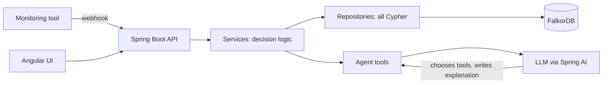
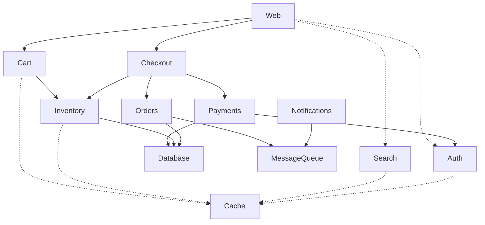

# Causeloom

**An incident root-cause agent that uses a FalkorDB service graph as its context layer.**

Built for Graph Hacks: Context for AI Agents, **Track 1: Agents That Act on Connected Data**.

When production breaks, monitoring fires a flood of alerts and no answer. Causeloom reads the alerts, walks a service dependency graph to find the one real root cause, measures the blast radius (including services that have not alerted yet), works out who to page (escalating if they are on leave), opens an incident, and explains the result with the graph path as proof.

> Without the graph, Causeloom does nothing useful. Root cause, blast radius, severity, on-call escalation and the path shown in the UI are all graph queries. The LLM only chooses which graph tools to call and writes the explanation.

<!-- Add 2 screenshots here: the impact graph with the failure path lit up, and the agent explanation panel. -->

## The scenario

A fictional online shop with 12 services. The Database fails, so everything that needs it starts failing.

- Five services alert: Payments, Inventory, Checkout, Cart and Database.
- **Auth** shows a small warning. It is a decoy: it is only `degraded`, so it is never a root cause.
- **Orders** and **Web** depend on the Database but have not alerted yet. These are the hidden victims.
- The Database on-call engineer (Ravi) is on leave, so the page goes up the management chain to Meera.

The agent names Database as the single root cause, flags Orders and Web before customers notice, escalates to Meera, and opens one incident.

## How it works



1. A monitoring tool (Prometheus Alertmanager, Datadog, CloudWatch, PagerDuty) sends `POST /api/alerts` with the service name, severity and message. Causeloom stores an `Alert` node, links it to the service, and marks the service `failing` (or `degraded` for warnings).
2. The agent runs. It decides which tools to call: active alerts, root cause, blast radius, on-call, severity, create incident.
3. Every tool is a thin wrapper over a Java service that runs Cypher against FalkorDB.
4. The API returns the explanation together with graph-computed facts. The UI draws the path from graph endpoints, never from the model's text.

Real alert payloads differ per tool, so a production setup adds a small adapter per tool that maps its payload to `{service, severity, message}`. The graph would be filled from Kubernetes, a service mesh, OpenTelemetry or a CMDB. The model stays the same.

## Graph data model

**Nodes**

| Label | Properties |
|---|---|
| `Service` | `name`, `tier`, `type`, `status` (`healthy`, `degraded`, `failing`) |
| `Team` | `name` |
| `Person` | `name`, `role`, `onLeave` |
| `Alert` | `id`, `severity`, `message`, `firedAt`, `status` (`open`, `resolved`), `resolvedAt` |
| `Incident` | `id`, `title`, `severity`, `status` (`open`, `closed`), `createdAt`, `closedAt`, `summary` |

**Relationships**

| Relationship | Meaning |
|---|---|
| `(Service)-[:DEPENDS_ON {critical}]->(Service)` | A needs B. `critical: false` means a failure slows A down but does not break it |
| `(Service)-[:OWNED_BY]->(Team)` | Owning team |
| `(Person)-[:ON_CALL_FOR]->(Team)` | On-call rotation |
| `(Person)-[:REPORTS_TO]->(Person)` | Escalation chain |
| `(Alert)-[:FIRED_ON]->(Service)` | Where an alert fired |
| `(Incident)-[:CAUSED_BY]->(Service)` | The root cause |
| `(Incident)-[:AFFECTS]->(Service)` | The blast radius |
| `(Incident)-[:INCLUDES]->(Alert)` | Alerts covered by the incident |
| `(Incident)-[:ASSIGNED_TO]->(Person)` | Who to page |

**Direction rule:** follow `DEPENDS_ON` forward to find a root cause, and backward to find the blast radius.

**Seed topology** (dashed arrows are non-critical dependencies):



## Key Cypher queries

**Root cause: a failing service with no failing dependency**
```cypher
MATCH (s:Service {status:'failing'})
OPTIONAL MATCH (s)-[:DEPENDS_ON]->(d:Service {status:'failing'})
WITH s, d WHERE d IS NULL
RETURN s.name
```
A failing service that depends on another failing service is only passing the failure along. The real cause sits at the bottom of the chain. The `OPTIONAL MATCH` plus `d IS NULL` is an anti-join.

**Blast radius: everything that depends on the root, directly or indirectly**
```cypher
MATCH p=(root:Service {name:'Database'})<-[:DEPENDS_ON*1..5]-(v:Service)
RETURN v.name, v.status, min(length(p)) AS hops
ORDER BY hops
```
Services in the result that are not `failing` are the hidden victims.

**Hard dependents: only paths made entirely of critical edges**
```cypher
MATCH p=(root:Service {name:'Database'})<-[:DEPENDS_ON*1..5]-(v:Service)
WHERE all(r IN relationships(p) WHERE r.critical = true)
RETURN count(DISTINCT v)
```

**Who to page, with escalation**
```cypher
MATCH (s:Service {name:'Database'})-[:OWNED_BY]->(t:Team)<-[:ON_CALL_FOR]-(p:Person)
RETURN t.name, p.name, p.onLeave
```
```cypher
MATCH path=(p:Person {name:'Ravi'})-[:REPORTS_TO*0..5]->(m:Person)
WHERE m.onLeave = false
RETURN m.name, m.role, length(path) AS hops
ORDER BY hops
LIMIT 1
```

**Graph algorithm: PageRank over service dependencies**
```cypher
CALL algo.pageRank('Service','DEPENDS_ON') YIELD node, score
RETURN node.name, score
ORDER BY score DESC
```

**Restore services after an incident closes, unless another open incident still covers them**
```cypher
MATCH (i:Incident {id: $id})-[:CAUSED_BY|AFFECTS]->(s:Service)
OPTIONAL MATCH (other:Incident {status:'open'})-[:CAUSED_BY|AFFECTS]->(s)
WITH s, other WHERE other IS NULL
SET s.status = 'healthy'
RETURN s.name
```

## Graph algorithms and severity

Severity is computed by the graph, not the model. It combines three inputs:

1. **Service tier** (tier 1 is customer-facing and starts at `high`).
2. **Hard dependents**: services reachable through critical-only edges. These are real outages, not slowdowns.
3. **PageRank position**: how structurally central the service is.

Rule: `critical` if the service has 5 or more hard dependents, or is tier 1 with at least 2. `high` if it is tier 1 or has 3 or more hard dependents. Otherwise `medium`. A top-3 PageRank position raises the level by one step, but only when real hard dependents exist.

The last condition matters. Raw PageRank ranks Cache above Database because Cache has more incoming edges. But every edge into Cache is non-critical, so a Cache failure means slower services, not an outage. Using the `critical` flag on each edge keeps Cache at `medium` while Database and Payments are `critical`.

## Agent tools

The LLM picks and calls these itself. It is not a scripted flow, and the UI shows the list of tools it actually called, in order.

| Tool | What it does |
|---|---|
| `getActiveAlerts` | Open alerts and the services they fired on |
| `findRootCause` | The root-cause query above |
| `getBlastRadius` | Dependents plus hidden victims |
| `getOnCall` | On-call person, with escalation if on leave |
| `getSeverity` | Graph-computed severity with its inputs |
| `createIncident` | Writes the incident back to the graph. Refuses duplicates and services that are not root causes |

Guardrails: every tool returns a truthful message (for example "already exists" or "service not found") because models repeat what tools say. The system prompt tells the model to describe only actions it actually performed, and never to claim it contacted anyone. Resolving an incident is a human action and is not exposed to the model.

## REST API

| Method | Path | Purpose |
|---|---|---|
| `POST` | `/api/alerts` | Monitoring webhook entry point |
| `GET` | `/api/alerts/active` | Open alerts |
| `GET` | `/api/services/root-cause` | Current root causes |
| `GET` | `/api/services/topology` | Whole service graph |
| `GET` | `/api/services/{name}/blast-radius` | Blast radius and hidden victims |
| `GET` | `/api/services/{name}/impact` | Nodes and edges for drawing the path |
| `GET` | `/api/services/{name}/severity` | Severity and its inputs |
| `GET` | `/api/people/responder/{service}` | Who to page |
| `GET` / `POST` | `/api/incidents` | List / create an incident |
| `POST` | `/api/incidents/{id}/resolve` | Close the incident, resolve alerts, restore services |
| `POST` | `/api/agent/investigate` | Run the agent |
| `POST` | `/api/demo/reset`, `/api/demo/simulate-outage` | Demo controls (off unless `CAUSELOOM_DEMO_ENABLED=true`) |

## Architecture

Backend (`backend/`, Java 25, Spring Boot 4.1, Spring AI, JFalkorDB): `controller -> service -> repository`. All Cypher lives in the repositories. Decision logic (escalation, hidden victims, severity) lives in the services. Agent tools are thin wrappers over the same services the REST API uses.

Frontend (`frontend/`, Angular 21, Cytoscape.js): feature folders `investigation`, `alerts`, `incidents` and `demo`, plus `shared` and `core`.

## Run it

You need Docker and an OpenAI API key.

```bash
git clone <this repo>
cd cause-loom
cp .env.example .env     # then set OPENAI_API_KEY and OPENAI_MODEL
docker compose up --build
```

Then open:

- App: http://localhost
- FalkorDB Browser: http://localhost:3000 (graph `incident`)
- API: http://localhost:8080

The graph is seeded on startup. In the app, press **Simulate outage**, then **Investigate**.

**Run without Docker for the app**

```bash
docker compose up -d falkordb
cd backend && ./mvnw spring-boot:run     # set OPENAI_API_KEY and OPENAI_MODEL first
cd frontend && npm install && npm start  # http://localhost:4200, proxies /api to :8080
```

**Configuration**

| Variable | Purpose |
|---|---|
| `OPENAI_API_KEY`, `OPENAI_MODEL` | LLM access. Never committed |
| `FALKORDB_HOST`, `FALKORDB_PORT` | FalkorDB location |
| `CAUSELOOM_SEED_ENABLED` | Wipe and reseed the graph on startup |
| `CAUSELOOM_DEMO_ENABLED` | Expose the demo endpoints. Off by default |

## Limitations

- The data is synthetic. The graph model matches what you would build from Kubernetes, a service mesh or tracing data.
- Causeloom names who to page but does not send notifications.
- When several unrelated failures happen at once, each root cause gets its own finding and incident. A single outage whose root cause never alerts at all is not inferred.
- One graph for one environment. Per-tenant graphs are a natural next step.